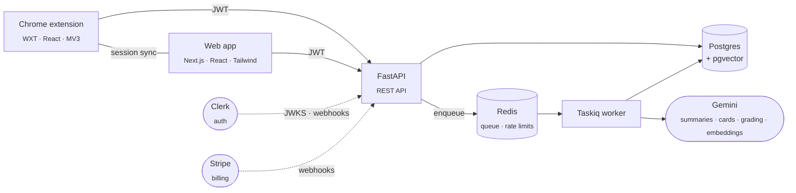

  

<h1 align="center">Remembrall</h1>

  <b>Turn what you read and watch online into long-term memory.</b> 
  <a href="https://remembrall.co">remembrall.co</a>

---

Remembrall is a browser extension and web app. You capture something while you browse: a passage, a full article, a social post or part of a YouTube video. An AI pipeline turns each capture into a structured summary and practice cards, and a spaced-repetition schedule brings it back just before you'd forget it.

I founded Remembrall (Remembrall Sweden AB) and built it end to end: the extension, the web app, the API, the AI pipeline and the infrastructure. **The production code is private.** This repository describes the product, the architecture and the main engineering decisions.

## How it works

1. **Capture.** One keyboard shortcut opens a capture card on any page. You can save a text snippet (verbatim), a full page (AI summary), a post from X, LinkedIn or Reddit, or a YouTube video (around the current moment, or the full transcript). On the web app you can also paste notes or upload PDFs.
2. **Process.** A background worker sends the capture to Gemini, which writes a structured summary document with text, math, charts and diagrams. Each capture is embedded with pgvector so related captures can be linked.
3. **Practise.** The worker generates multiple-choice, flashcard and open-ended questions. Open-ended answers are graded by the AI.
4. **Remember.** The spaced-repetition schedule decides what is due and builds practice sessions over one capture, a deck, a project or the whole library.

## Architecture

| Layer | Stack |
|---|---|
| Extension | WXT, React 19, Tailwind 4, TypeScript, Chrome Manifest V3 |
| Web app | Next.js 16 (App Router), React 19, Tailwind 4, TypeScript (on Vercel) |
| API | Python 3.12, FastAPI, asyncpg (raw SQL, no ORM), PyJWT (on Railway) |
| Background jobs | Taskiq on Redis |
| Data | PostgreSQL + pgvector |
| AI | Gemini 2.5 Flash (generation, grading, embeddings) |
| Auth and billing | Clerk, Stripe |
| Observability | Sentry (one project per component), structured JSON logs |

## Engineering highlights

- **Scheduling per capture, not per card.** Spaced-repetition state belongs to the capture, so one source is never split into dozens of separately scheduled cards. A capture can be due, resting, snoozed, untracked or blocked. Snoozing works at capture, deck or project level, and sessions mix card types with presets (recommended, new, random, hardest, confusable).
- **The API never calls the LLM.** The API only writes to the database and enqueues jobs. All Gemini calls run in a separate Taskiq worker, so slow or failing model calls never block requests. Each request ID is passed into the worker task, so one user action can be traced across both processes.
- **AI cost and abuse guards.** Each plan has daily limits on credits, tokens and AI requests. Attempt caps per capture, per job and per answer stop a failing item from being re-sent to the model forever.
- **An eval harness for prompts and models.** A CLI replays the real production prompts over frozen fixtures against several models (Gemini, plus other vendors through OpenRouter). It scores every output with deterministic checks and an LLM judge, and stops new calls once a spend cap is reached.
- **One sign-in across three clients.** The extension has no login screen of its own. It picks up the web app's Clerk session, and our code never stores a token. The backend checks RS256 JWTs against Clerk's JWKS and keeps users in sync through signed webhooks.
- **Privacy by default in telemetry.** Logs and Sentry events carry only an opaque user ID: no emails, IPs, captured content, prompts, model outputs or page URLs. Each component scrubs events before sending them.
- **Production basics.** Liveness and readiness probes (DB, Redis and worker heartbeat), numbered SQL migrations that must run before deploys, staged releases through fast-forward merges only, and `detect-secrets` in pre-commit.

## Status

Preparing for public launch. Billing (Free / Pro / Ultra on Stripe, with a 14-day Pro trial and an EU right-of-withdrawal flow) is in place.

## Contact

Connor Kennedy, founder and developer · [LinkedIn](https://www.linkedin.com/in/connorborjesonkennedy/) · [GitHub](https://github.com/connorbk)
